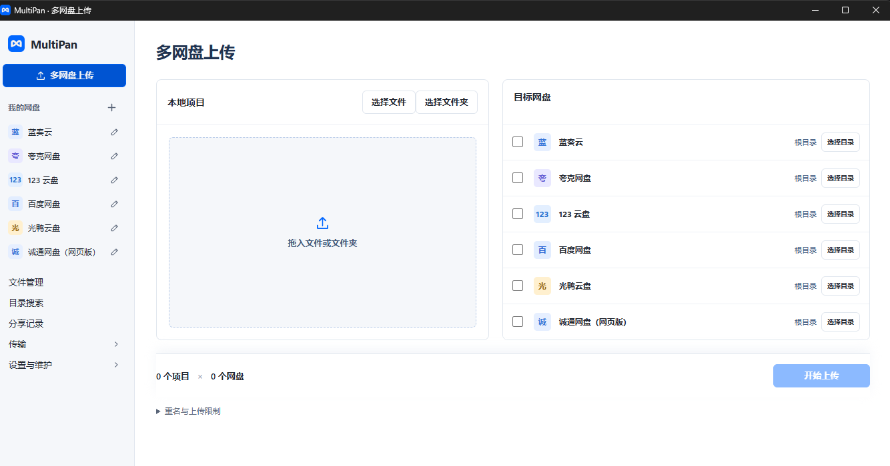
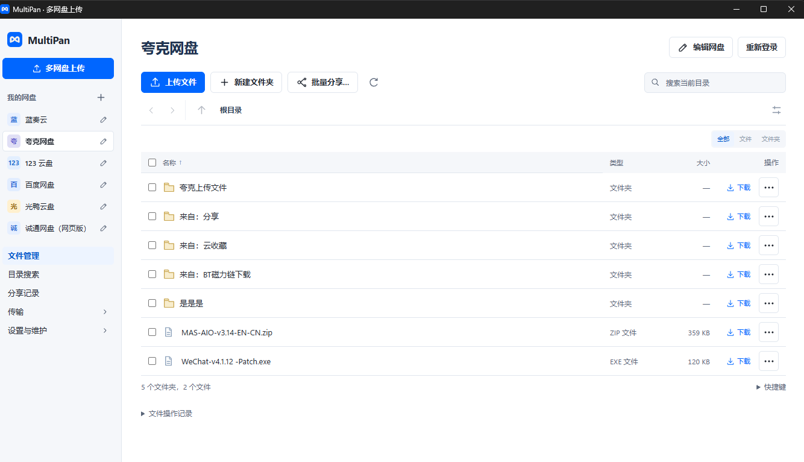
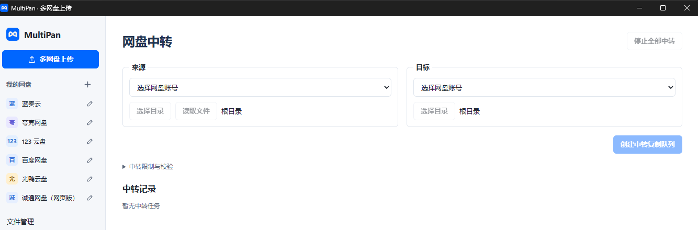

# MultiPan


多网盘桌面客户端。选择一次本地文件或文件夹，即可上传到多个网盘。文件在本机与网盘间直接传输，无需自建服务器。

[](https://github.com/makessr/MultiPan/actions/workflows/windows.yml)

## 核心能力

| 功能 | 可以做什么 |
| --- | --- |
| 多网盘上传 | 一次选择本地文件或文件夹，为各账号指定目标目录后并行上传。选定一个目录后会自动匹配其他网盘里的相近目录，并在上传前核对同名冲突。详见[使用](#使用)。 |
| 文件管理 | 按账号浏览目录、搜索、下载和移动文件。批量复制可继续处理尚未提交的项目。光鸭可直接把文件和文件夹复制到同账号已有目录，文件副本按 SHA-256 核对。复制与分享能力随网盘而异。 |
| 传输队列 | 管理上传和下载任务，设置并发与合计限速。在来源和会话满足条件时可断点续传。 |
| 跨网盘中转 | 经本机缓存复制文件或目录。支持单文件、同一账号组合批量和目录内文件搬运。逐项核对后处理源文件，保留源目录。 |
| 分享管理 | 在支持的网盘创建、复制和管理分享。在本机可查看操作回执、按筛选清理已确认记录，并跟进 123 付费分享审核。批量核对进度在翻页和切换筛选后保留，可从创建回执核对原项目并重新分享，合并分享沿用原范围，新回执可单独确认撤销旧链接。见[分享管理](docs/SHARE-MANAGEMENT.md)。 |

已接入蓝奏云、夸克网盘、123 云盘、百度网盘、光鸭云盘、诚通网盘（网页版，实验）、诚通 WebDAV 和通用 WebDAV。诚通网页版账号通过内嵌窗口登录，登录成功后自动带回令牌（窗口会同时从请求头和网页本地存储读取，重登不会停在等待登录），列目录时会自动确定账号的工作空间；上传、下载、新建文件夹、改名和删除按网页端同一套请求发送，并和工作空间一起协商。删除会先确认并说明该项目不进回收站，确认后直接删除。接入依赖网页端内部接口，服务端调整后可能失效。

## 界面

以下截图取自 Windows 桌面版，账号与目录仅用于演示。

多网盘上传：选择一次本地文件或文件夹，为每个账号挑选目标目录，上传前统一核对同名冲突。



文件管理：按账号浏览目录、搜索、下载、移动，并对选中的项目执行批量操作。



网盘中转：在两个账号之间经本机缓存复制文件或目录，逐项核对后处理源文件。



## 使用

### 先添加账号

在左侧「我的网盘」点「+」，选择网盘后按提示操作。蓝奏云、夸克、123、百度、光鸭和诚通网页版会打开内嵌登录窗口，登录成功即自动保存账号，不需要手动填 Cookie 或令牌；诚通网页版同时带回令牌并确定账号的工作空间。诚通 WebDAV 和通用 WebDAV 需要填门户地址与用户名、密码。账号与任务状态只保存在本机。

### 多网盘上传

一次选好本地项目，给每个账号指定目标目录，剩下的交给程序：

1. 打开「多网盘上传」，点「选择文件」「选择文件夹」，或把文件直接拖进虚线框。支持一次混放多个文件和文件夹，文件夹按原有层级上传。
2. 在右侧「目标网盘」勾选账号，可以多选；再逐个点「选择目录」指定落点。
3. 给第一个账号选好目录后，程序会自动在其余账号里查找名称相近的目录，点「候选目录」里的路径就能直接采用，见下一节。
4. 「开始上传」会先读取各目标目录核对同名项目，并给出上传计划：同名文件默认跳过，唯一的同名文件夹可以复用，既不覆盖也不自动改名；读取不到的项目默认跳过，可以勾选后按网盘规则再试。
5. 确认后创建任务，进度在「上传任务」查看。失败项可以单独重试，同一批次按目标网盘和根文件夹分组统计；在来源和会话满足条件时可以断点续传。

### 就近选择目录

逐个账号翻目录很费时间，所以只需给一个账号选好目标，其余账号由程序按名称匹配：

- 忽略空格、标点和全角半角差异，数字的前导 0 视为相同（`002026` 与 `2026` 匹配）。
- 容忍少量错字，名称较长时可以容两处；也匹配「…备份」这类前后缀差异。
- 目标多套了一层目录时可以跳过该层，直接命中真正的目标；路径中会保留被跳过的目录名，便于确认。
- 命中多处时全部列出（每级最多 8 个候选）；只匹配到中间层时，点选后会继续往下查找剩余层级。

匹配以名称和层级为准，所以要先从根目录逐级选到目标才会触发；用搜索跳转或直接点深层目录得到的路径只作为本次选择，不参与匹配。

### 其他常用操作

| 想做的事 | 操作位置 |
| --- | --- |
| 浏览、搜索、下载、重命名、移动单个网盘里的文件 | 「我的网盘」选中账号后的文件列表；勾选项目后可用「下载」「加入下载队列」「移动到…」「复制到…」「分享…」 |
| 在两个网盘之间搬文件 | 「传输 → 网盘中转」，选来源与目标后创建队列；逐项核对内容再处理源文件，源目录默认保留 |
| 创建、核对和撤销分享 | 文件列表的「分享…」，结果在「分享记录」查看；旧链接可单独撤销，合并分享沿用原范围 |
| 调整并发、限速与托盘行为 | 「设置与维护 → 传输设置」 |
| 处理失败与待核对项 | 「传输 → 上传任务」的失败项，或「设置与维护 → 待核对中心」 |

## 下载与安装

支持 Windows 10/11 x64、Windows 11 ARM64、Ubuntu 24.04 / Debian 13（amd64 与 arm64）和 macOS（Apple Silicon 与 Intel）。Windows 需要 Microsoft Edge WebView2 Runtime。

1. 打开[最新正式版](https://github.com/makessr/MultiPan/releases/latest)，或从 [Releases](https://github.com/makessr/MultiPan/releases) 选择具体版本。当前正式版为 1.0.0。
2. 按系统和架构下载对应文件，并用附带的 `.sha256` 摘要核对：
   - Windows x64：`multipan.exe` 直接试用，`MultiPan-setup.exe` 安装到当前用户，`MultiPan-1.0.0-windows-x64-all-users.msi` 安装到所有用户
   - Windows ARM64：`multipan-windows-arm64.exe`、`MultiPan-1.0.0-windows-arm64-setup.exe`、同架构 MSI
   - Linux：`multipan_1.0.0_amd64.deb` 或 `multipan_1.0.0_arm64.deb`
   - macOS：`MultiPan-1.0.0-amd64-macOS.zip` 或 `MultiPan-1.0.0-arm64-macOS.zip`
3. 想试最新的开发构建时，从 [Windows 构建](https://github.com/makessr/MultiPan/actions/workflows/windows.yml) 或 [Linux 与 macOS 构建](https://github.com/makessr/MultiPan/actions/workflows/desktop-unix.yml) 的产物区下载对应架构的压缩包。压缩包内附 SHA-256 摘要和[试用指南](TRIAL-GUIDE.txt)。

全用户安装需要确认 UAC。安装后，`MultiPan-setup.exe --action install --inspect-machine-integration --silent` 会以 `"installer": "msi"` 报告系统级登记的归属，卸载请走「设置 → 应用」。

1.0.0 正式版按项目决定不带 Authenticode 证书，Actions 产物同样未签名：安装和打开时系统可能提示「未知发布者」，请用 Release 页的 SHA-256 摘要核对文件；仓库日后配置证书后，Windows 产物会自动带上签名与时间戳（见[Windows 代码签名](docs/WINDOWS-SIGNING.md)）。安装完成后按上面的[使用](#使用)添加账号并上传第一批文件。

### Linux

Ubuntu 24.04 或 Debian 13 桌面提供独立的 amd64 和 arm64 安装包。运行 `dpkg --print-architecture` 确认架构，从 [GitHub Releases](https://github.com/makessr/MultiPan/releases) 或 [Linux 与 macOS 构建](https://github.com/makessr/MultiPan/actions/workflows/desktop-unix.yml) 下载对应的 `.deb`，再运行 `sudo apt install ./安装包文件名.deb`。Linux 通过手动导入登录信息添加账号，WebDAV 沿用用户名和密码。

也可以在核对公钥指纹后加入签名 APT 源 `https://makessr.github.io/MultiPan`，用 `sudo apt install multipan` 安装，之后随 `sudo apt update` 升级。每个公开发布的版本会自动更新该源，并保留上一版安装包供旧缓存访问；需要补发时在「Actions → 发布 APT 仓库」手动指定标签运行。源内目前提供 1.0.0 的 amd64 与 arm64 安装包。

Linux 构建、APT 源发布及保留历史索引的流程见[桌面版分发文档](docs/DESKTOP-DISTRIBUTION.md#发布-apt-源)。

### macOS 预览版

提供 Apple Silicon 和 Intel 独立 ZIP。预览包未经 Apple 公证，首次启动可能被 Gatekeeper 拦截。具体下载位置见[桌面版分发文档](docs/DESKTOP-DISTRIBUTION.md#macos-预览版)。

### Windows 在线更新

Windows 客户端可在「传输设置 → 应用更新」检查 [GitHub Releases](https://github.com/makessr/MultiPan/releases) 中的正式版本。下载优先走 gh-proxy.com 和 ghproxy.net，失败时自动切换，GitHub 直连兜底。1.0.0 不带 Authenticode 证书，客户端会拒绝安装未签名的更新包，因此本版请从 Releases 手动下载覆盖安装；配置证书后再按[签名与发布流程](docs/UPDATE-RELEASE.md)恢复自动更新，并核对 x64 和 ARM64 的清单与安装包。


## 开发计划

| 优先级 | 方向 | 接下来要做的事 |
| --- | --- | --- |
| 当前优先 | 分享管理 | 核对夸克、123 和百度仍待接入的已有分享设置，以及蓝奏已发布分享列表和独立撤销所需的接口依据。新分享记录可在重启后继续核对旧链接撤销回执。 |
| 停止开发 | 删除与回收站 | 保留已交付功能和历史记录。 |
| 待推进 | 盘内文件操作 | 补夸克原生复制和蓝奏文件夹移动。 |
| 停止推进 | 跨网盘复制与搬运 | 保留已交付的夸克与光鸭原件预读（单文件 8 GiB、单批或目录 16 GiB），不再扩大可核对的来源范围，删源搬运按范围暂停。 |
| 延后 | 诚通公开分享 | 核对 WebDAV 账号与公开分享所需独立登录会话之间的授权方式。 |
| 已发布 | 正式发布 | 1.0.0 已作为正式版发布（不带 Authenticode 签名）。Windows x64 和 ARM64 更新均已接入。系统级安装已在隔离环境验证首次安装中断后归档重试、升级中断后恢复原版。发布前核对包含双架构 APT 仓库校验。Windows 开发安装器可只读核对系统级登记和公共快捷方式。全用户 MSI 已随 1.0.0 发布，实际 UAC、跨用户启动及卸载待验收。Linux 仓库已发布在 GitHub Pages 的签名 APT 源上。macOS 提供未公证预览包。 |

夸克和光鸭原件预读支持单文件 8 GiB、单批或目录 16 GiB。夸克缺少修改时间时可通过完整内容核对完成中转复制。Windows 系统级安装隔离预检可识别被修改的卸载命令和快捷方式。受保护卸载已在隔离目录验证文件占用、篡改拒绝和重新安装。

完整范围、进展和验收记录见[开发计划](docs/DEVELOPMENT-PLAN.md)。真实账号、桌面操作和多平台安装的逐步验收见[手动测试清单](docs/MANUAL-TEST-CHECKLIST.md)。

## 从源码构建

技术栈为 Go、Wails 3、Vue 和 TypeScript。下面的 Windows 构建需要 Windows x64、WebView2、Go 1.26 或更新版本，以及 Node.js 26。Linux 与 macOS 的构建步骤见[桌面版分发文档](docs/DESKTOP-DISTRIBUTION.md)。

```powershell
go install github.com/wailsapp/wails/v3/cmd/wails3@v3.1.0
./scripts/build.ps1 -AppName multipan
./scripts/package-installer.ps1 -ApplicationPath bin/multipan.exe -OutputPath bin/MultiPan-setup.exe
```

请确认 `wails3` 所在的 Go 工具目录已加入 `PATH`。构建脚本生成图标和 Wails 绑定，运行 Go 测试、Go vet 和前端专项检查。本地默认额外检查五家网盘的登录窗口能否打开，装有 Windows SDK 时再运行一次代码签名自检。CI 使用同一构建脚本，跳过需要交互桌面的登录窗口检查，并打包、核对安装器及上传产物。

准备新版本时先用 `./scripts/set-version.ps1 -Version 1.0.0` 同步三处版本号（加 `-DryRun` 只检查），再补 CHANGELOG 与 README。配置代码签名证书后，`./scripts/sign-windows-bundle.ps1` 可给已打包的文件补签名与时间戳并重算校验和。

Linux CI 会按架构和 APT 解析出的依赖清单复用 Debian 包缓存。依赖版本变化时自动重新下载。

## 源码目录

| 目录 | 内容 |
| --- | --- |
| [frontend/](frontend) | Vue 界面及 Wails 生成的前端绑定 |
| [internal/desktop/](internal/desktop) | 桌面启动、窗口、托盘和前端调用的 Go 服务 |
| [internal/transfer/](internal/transfer) | 网盘协议、账户状态、任务与传输逻辑 |
| [internal/installation/](internal/installation) | 安装、升级和应用更新 |
| [build/](build) | 各平台构建配置、图标及系统打包资源 |
| [scripts/](scripts) | 本地构建、验证和发布入口 |
| [tools/](tools) | 开发工具及前端回归 |
| [docs/](docs) | 开发计划、发布和分发文档 |

根目录的 main.go 是 Wails 程序入口，负责嵌入界面和配置，并启动桌面应用。

## 贡献

欢迎提交 Issue 和 Pull Request。较大改动建议先通过 Issue 对齐范围。

- 从工作分支开发，通过 PR 合并到 `main`。合并前须通过必需的 CI 检查。
- 提交 PR 前，在 Windows 运行 `./scripts/build.ps1 -AppName multipan-pr-check`。该入口包括 Vue 类型检查和生产构建、Go 测试、`go vet` 及前端专项回归。
- 每个开发提交同步更新本 README。PR 标题和说明统一用中文，注明用户可见变化、已执行的验证和待手动验收事项。
- 每次发布前按[发布前检查](docs/RELEASE-CHECKLIST.md)核对合并提交、CI 和待发布附件。`scripts/check-release-readiness.ps1` 在 Windows PowerShell 5.1 和 PowerShell 7 下都能运行；在 Windows 上用 `powershell -NoProfile -ExecutionPolicy Bypass -File ./scripts/check-release-readiness.ps1 -Commit <提交>` 调用。按项目决定不带签名的正式版在核对草稿时加 `-Unsigned`，脚本会改为核对便携版、当前用户安装程序和双架构安装包，跳过已签名安装包与在线更新清单。

## 本机数据

- 账号和任务状态保存在本机，在 Windows 使用 DPAPI，在 Linux 使用 Secret Service，在 macOS 使用系统钥匙串保护加密密钥。传输缓存和操作回执也由本机管理。
- GitHub PR 标题、正文和版本更新记录以中文为主。PR 请写明变更、验证结果和仍需手动验收的场景。
- 查看[更新记录](CHANGELOG.md)、[第三方许可说明](THIRD_PARTY_NOTICES.md)和[历史记录](docs/HISTORY-0.46-0.62.md)。

## 许可证

MultiPan 项目源码按 [Apache-2.0](LICENSE) 发布。第三方组件继续适用各自的许可证，见[第三方许可说明](THIRD_PARTY_NOTICES.md)。
